# Search strategies for a faulted circuit on real hardware

Evolutionary Robotics  
Kallen Selby  
November 2026

The analysis headings below are open on purpose. Each one has a few prompts and, where the next experiment was a direct response to the one before it, that reason is written out. The conclusions are still yours to write.

## 1. The question

The original proposal asked whether evolution can restore an FPGA circuit after injected configuration faults, and how fault severity changes the number of evaluations that takes. On a narrow search, where evolution may touch only the bits that were faulted, that restoration is fast. XOR, a 2-bit adder, and a 4-bit adder all returned to a perfect score in a handful of board tests.

The work after that asks a different question, because opening the logic tile made the same small fault hard:

**Once evolution may rewrite the logic tile, which search strategies improve a faulted circuit on the chip, how much of the score comes back before it stalls, and what does the genome do while the best score is stuck?**

The circuit is the body, the injected fault is the damage, and fitness is restored behavior. Every candidate is scored on the silicon, not in simulation. The result in the open tile is a partial climb and then a stall. The report is about that climb and that stall.

Three measurements carry the comparison.

- **Best fitness** is the fraction of scored cases the best genome got right. A perfect circuit is 1.0.
- **The climb** is that best fitness minus its value at generation 0. Generation 0 is the initial population after it has been scored. That population is the damaged circuit plus mutants of it, so generation 0 can already sit above the damaged circuit alone. Where the damaged seed's own score was recorded, it is named separately.
- **The genome during the stall** is two distances. Champion distance is how many bits the best genome differs from the original, undamaged tile. Population spread is the mean Hamming distance between pairs of genomes in that generation.

Almost every run is one fault seed, and several were stopped before the generation they were planned for. Read each curve as one designed probe. A line that has gone flat has stopped improving. It has not been shown that a longer run would stay flat.

## 2. The hardware and the measurement

The board is a Pico2-ICE: an RP2350 microcontroller beside an iCE40UP5K FPGA. The known-good circuit is placed and routed with Yosys and nextpnr, packed with IceStorm, and loaded by the RP2350 over a USB serial session. The microcontroller drives the inputs and reads the outputs. Fitness is the fraction of cases that match the truth table. The host keeps the population. The board holds the scorer and the bitstream under test.

The circuit that the later runs try to repair is a 2-bit adder in one logic tile. Three of the tile's eight cells are used. Carry runs from the low sum bit into the high sum bit and then into the carry out. The rest of the chip is left as placed.

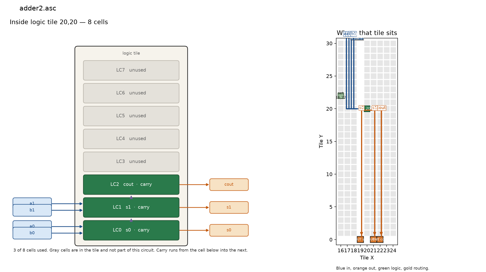

*Figure 1. The placed 2-bit adder. The left panel is logic tile (20, 20). The right panel is where that tile sits on the iCE40.*

| Signal | FPGA pin | RP2350 GPIO |
| --- | --- | --- |
| a0 | ICE_27 | GPIO20 |
| a1 | ICE_26 | GPIO24 |
| b0 | ICE_25 | GPIO30 |
| b1 | ICE_23 | GPIO25 |
| s0 | ICE_20 | GPIO22 |
| s1 | ICE_19 | GPIO23 |
| cout | ICE_18 | GPIO27 |

The 2-bit adder uses the on-board pin bank, with no jumper wires. A known-good bitstream scored 16/16 before any fault was injected. XOR, used later as a step-size probe, lives in tile (8, 1) and is scored as correct measurements out of 20 (4 input patterns, 5 repeats). The 4-bit adder lives in tile (17, 1). Its narrow-repair runs are scored out of 1280 (256 sums, 5 repeats). From the open-tile 2-bit runs onward, adder fitness is one pass over the 16 sums: a row counts only when `s0`, `s1`, and `cout` all match.

A fault clears bits that the original bitstream had set to 1. The draw is a fixed seed, usually 42: sample 8 of those ones and take the first 4, or the first 8 in the early severity check. The same seed in a different genome does not land on the same index list, because the indexes are positions in that genome. Those lists are given with each setup.

What evolution is allowed to write changed in three steps.

1. **Narrow repair.** Only the faulted bits may change. A 4-bit fault is a search of 16 genotypes. An 8-bit fault is 256.
2. **The whole tile.** Any bit in the active logic tile may change, including bits that started at 0.
3. **The named bits.** IceStorm can name 807 bits in the tile. Those are the genome. The other 57 bits in the tile stay as they are. Crossover, when it is used, swaps whole groups of those bits: a LUT, a flip-flop, a wire, a routing mux, the clock select, or a carry bit. There are 274 such sections.

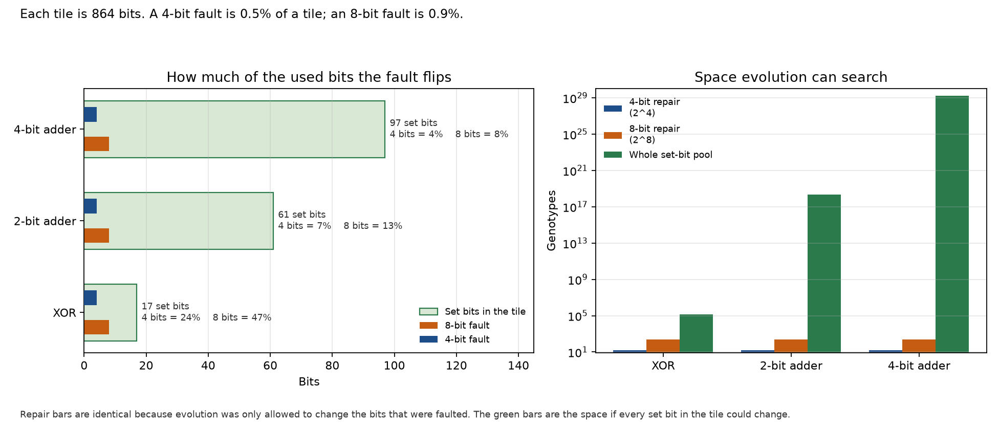

*Figure 2. The narrow-repair regime. The short bars are the fault. The tall pale bars are the bits that start as 1. The right panel is the number of genotypes if evolution may change only the fault, against the number if it may change every bit that starts as 1. The runs after Section 3 are larger than those green bars: zeros in the tile become writable, and the later genome is 864 raw tile bits or 807 named bits.*

A generation scores the population, keeps the elites unchanged, and fills the rest with children. Elites are not sent to the board again. Parents are chosen in proportion to fitness. A run stops if fitness hits 1.0, except the last experiment, which is written to keep going. `--generations` counts the steps after the initial score, so a plot that runs to generation 25 has 26 scored populations.

## 3. Narrow repair

### Why this experiment

The first question was the proposal's question. A fault sweep on XOR had already shown that clearing 4 of the 17 ones in the active tile dropped the score to about half, and that the damaged circuit did not pass on its own. The search was then locked to those same bits, so a recovery would mean evolution had put back a working configuration inside a space small enough to interpret.

### Setup

All six runs share this loop. The population is 10 copies of the damaged genome at the start, then mutation-only children. There is no crossover. One elite is kept. Each allowed bit flips on its own with probability 1/N, so a child is expected to flip one bit. The budget is 30 generations or a perfect score, whichever comes first. Fault seed 42.

| Run | Circuit and tile | Fault | Search size | Fitness | Flip probability |
| --- | --- | --- | --- | --- | --- |
| XOR, 4 bits | tile (8, 1), 17 ones | 4 bits | 16 genotypes | correct / 20 | 0.25 |
| XOR, 8 bits | same tile | 8 bits | 256 genotypes | correct / 20 | 0.125 |
| 2-bit adder, 4 bits | tile (20, 20), 61 ones | 4 bits | 16 genotypes | correct / 80 | 0.25 |
| 2-bit adder, 8 bits | same tile | 8 bits | 256 genotypes | correct / 80 | 0.125 |
| 4-bit adder, 4 bits | tile (17, 1), 97 ones | 4 bits | 16 genotypes | correct / 1280 | 0.25 |
| 4-bit adder, 8 bits | same tile | 8 bits | 256 genotypes | correct / 1280 | 0.125 |

### What the overlay shows

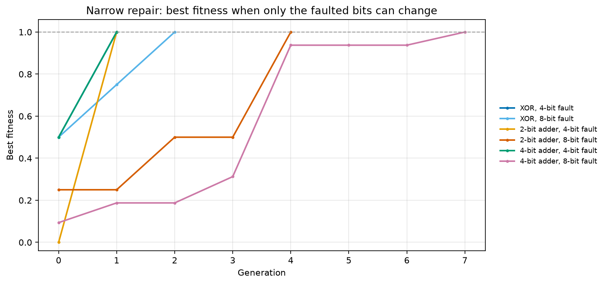

*Figure 3. Best fitness while evolution may change only the faulted bits. The dashed line is a perfect score. Every run reaches it.*

| Run | Generation 0 | Recovered | Board tests | Champion, bits from the original |
| --- | --- | --- | --- | --- |
| XOR, 4-bit fault | 0.50 (10/20) | generation 1 | 5 | 3 |
| XOR, 8-bit fault | 0.50 (10/20) | generation 2 | 12 | 4 |
| 2-bit adder, 4-bit fault | 0.00 | generation 1 | 5 | 2 |
| 2-bit adder, 8-bit fault | 0.25 | generation 4 | 21 | 2 |
| 4-bit adder, 4-bit fault | 0.50 | generation 1 | 5 | 3 |
| 4-bit adder, 8-bit fault | 0.09 | generation 7 | 36 | 3 |

The repaired genome is a perfect scorer in every run, and it is not the original bitstream. A few of the faulted bits are still different when the score hits 1.0.

### Analysis

Write this. A few things the curves put in front of you:

- The 4-bit faults are done in one generation. The 8-bit faults take longer, and the 4-bit adder's 8-bit fault is the slow one, but all six finish inside 36 board tests.
- A perfect score here is a working circuit, and the champion is still 2 to 4 bits off the original. What should "recovered" mean if the behavior is back and the bits are not?
- This search never has a stall to describe. The interesting genotype question shows up only after the mask is opened.

### Why the search was opened

Repairing only the damaged bits was too small a problem. The next runs let the adder rewrite the tile around the fault, which is the setting a self-repair story actually has: the chip does not know which bits were hit.

## 4. Opening the tile

### Why this experiment

With the fault mask removed, the first attempt was the 4-bit adder, allowing any of the 97 bits that start as 1 to change and leaving zeros fixed. That run was interrupted by a hung board call. The 2-bit adder was then given the whole tile, 864 bits, including bits that start at 0. The first of those runs copied a large mutation rate across from an earlier setting. The second cut that rate down, because the large steps looked like they were knocking improved circuits off the score they had just earned.

### Setup

Both 2-bit runs use the same circuit, the same fault, and no crossover. Fitness is correct rows out of 16. The fault seed is 42, and in this 864-bit genome the cleared genes are 29, 44, 254, and 309. The initial population is the damaged tile plus mutants of it. Each bit flips independently, so the flip count varies around the expected value. Elites are copied and not scored again.

| Setting | Large step | One flip |
| --- | --- | --- |
| Genome | all 864 bits of tile (20, 20) | same |
| Population | 20 | 30 |
| Elites | 5 | 3 |
| Flip probability | 0.02, about 17 flips per child | 1/864, about 1 flip per child |
| Generations planned | 30 | 50 |
| Generations run | 0–30 | 0–50 |
| Board tests | 470 | 848 |
| Output | `adder2/evolution/out/direct_4bit/` | `adder2/evolution/out/direct_4bit_p30_g50/` |

The 4-bit open-mask run is on the figure as a reference, and it is not the same experiment. Any of the 97 bits that start as 1 could change. Zeros stayed fixed. Population and mutation were the narrow-repair settings scaled up to that mask. The board hung on the call after physical evaluation 102, during generation 20. Generations 0–13 were not retained. The saved generations are 14–19.

### What the overlay shows

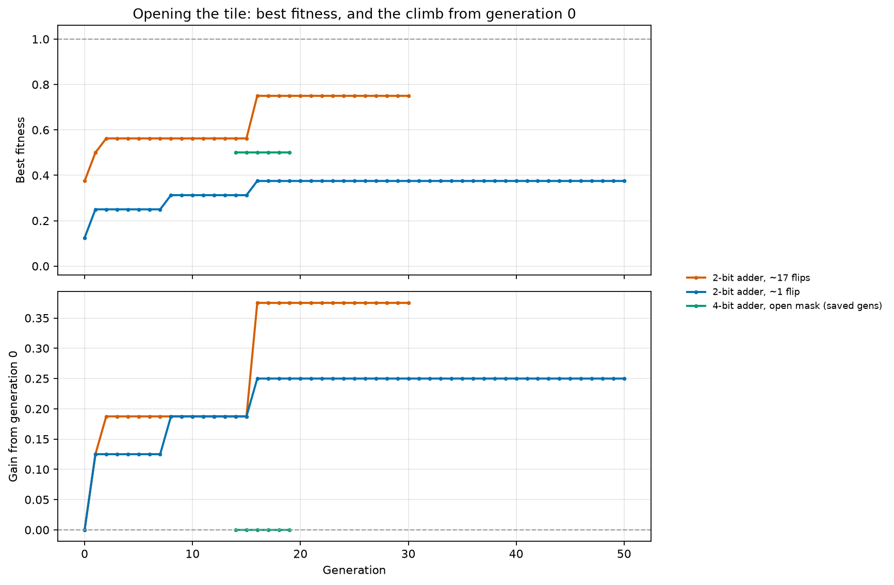

*Figure 4. Best fitness after the fault mask was removed, and the same curves as a gain over generation 0. The green line is only the saved part of the interrupted 4-bit run, and it does not move.*

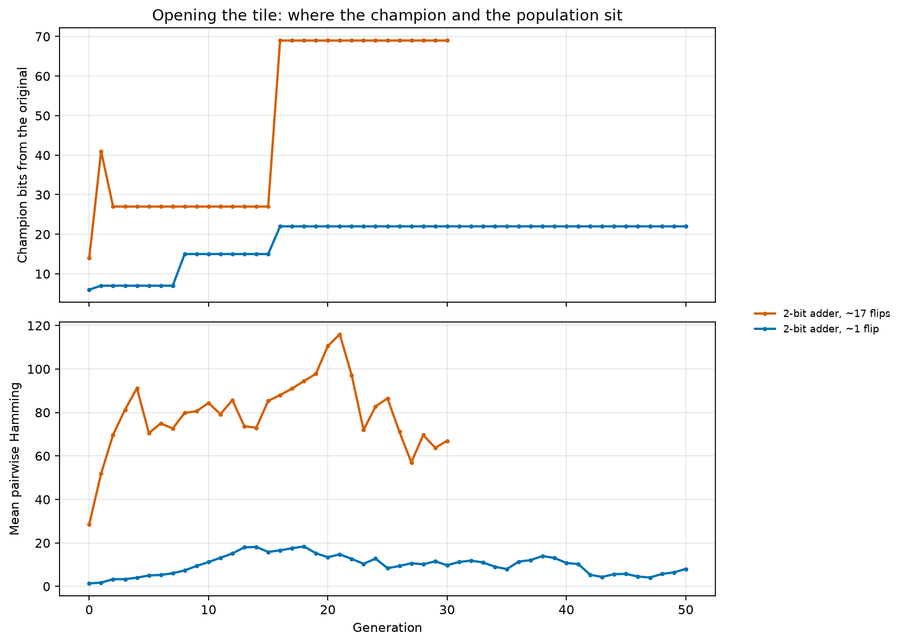

*Figure 5. Champion distance from the original tile, and mean pairwise Hamming, for the two 2-bit runs. The interrupted 4-bit run is left off this figure. Its saved champion stays 4 bits from the original, and the population stays about 5 bits apart.*

The large-step run's best score moves from 0.375 at generation 0 to 0.750 at generation 16 (6/16 to 12/16) and stays at 12/16 through generation 30. From generation 16 on, the champion stays 69 bits from the original. The population tightens around it, from about 88 bits of pairwise distance to about 67. The notes from that run record that 2 of the 4 fault bits were back on, and that many bits which had been 0 were turned on.

The one-flip run moves from 0.125 to 0.375 at generation 16 (2/16 to 6/16) and stays there through generation 50. The champion stays 22 bits from the original. The notes from that run record that the four fault bits were still off, with 18 other bits turned on. Pairwise distance falls from about 17 to about 8.

The saved portion of the 4-bit open-mask run sits at 0.50, and the best genome in those generations is still the damaged start.

### Analysis

- The large step gains 6 rows and then freezes. The one-flip run gains 4 rows and freezes lower. Both champions are finished moving at generation 16, which is the last time the score rises.
- After that, the population pulls inward and the champion's distance does not. The stall here is a frozen winner with a cloud shrinking onto it.
- The one-flip champion is closer to the original (22 bits) and scores worse (6/16) than the large-step champion (69 bits, 12/16). Is the higher score a repaired adder, or a different circuit that passes more rows?
- Generation 0 is already 0.375 in the large-step run and 0.125 in the one-flip run. The damaged seed of the large-step run was recorded as scoring 0, so part of that run's climb happened in the initial mutants. Decide whether the climb should be counted from the seed or from generation 0, and use the same rule everywhere.

### Why the genome changed

Bit-wise mutation on all 864 bits had two failure modes. A large step could raise the score and then had no small move left that would keep a good circuit. A small step raised the score less and left the fault bits off. The next genome is the 807 bits IceStorm can name, and children are built by swapping whole sections, so a LUT or a wire moves as one piece instead of as scattered bits.

## 5. Named bits, and moving once the score is flat

### Why these experiments

These four runs share the new genome and the same 4-bit fault. The section-crossover run is the baseline on that genome. It reached 10/16 and sat there. The hill climbers ask what happens if a genome is allowed to keep a change that does not improve the score, with no competition and no crossover. Inchworm asks what happens if the mutation rate itself grows while the best score is stuck, and snaps back when a better score appears.

### Shared setup

| Setting | Value |
| --- | --- |
| Circuit | 2-bit adder, tile (20, 20) |
| Genome | 807 named bits. The 57 unnamed bits stay fixed |
| Fault | seed 42. Cleared genes 26, 41, 235, and 286 |
| Fitness | correct rows / 16 |
| A child, when crossover is used | two fitness-proportional parents. Each of the 274 sections comes from either parent with probability 0.5, so the mix is not biased toward the fitter parent |
| Mutation, when it is a rate | each bit flips with probability (expected flips) / 807 |

The section run and inchworm keep elites, copy them, and do not score them again. The hill climbers have no elites and no crossover. Each genome is mutated on its own and kept when the new score is at least as high as the old one. A tie replaces the parent, so the genome can walk without a better score.

| Setting | Section crossover | One hill climber | Five hill climbers | Inchworm |
| --- | --- | --- | --- | --- |
| Population | 23. One damaged genome plus 22 mutants | 1, the damaged genome | 5. The damaged genome plus 4 mutants | 20. One damaged genome plus 19 mutants |
| Elites | 3 | none | none | 5 |
| Expected flips | 4 | 4 | 4 | 1, rising while the best score is stuck |
| Who competes | the whole population | each climber alone | each climber alone | the whole population |
| Generations | 100, all completed | 100, all completed | 100, all completed | 500 planned, stopped during 176 |
| Board tests | 2020 | 97 | 500 | 2642 |

Inchworm's rate rule: the first four generations at a given best score use 1 expected flip for every child. On the fifth generation at that score, the 5 children whose parents have the lowest average fitness move to 5 expected flips. Every three further generations at that score adds 4, up to 40. A strictly better best score puts every child back to 1. The other children stay at 1 the whole time.

### What the overlay shows

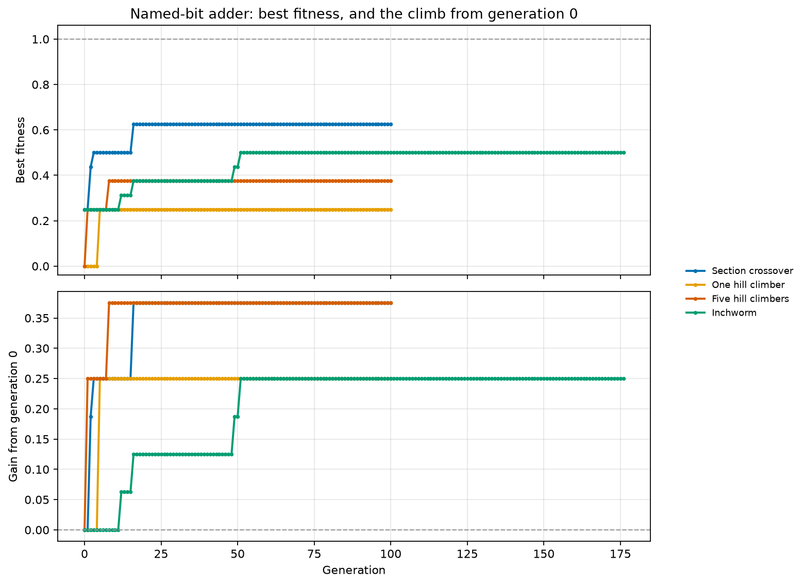

*Figure 6. Best fitness on the named-bit adder, and the gain from generation 0.*

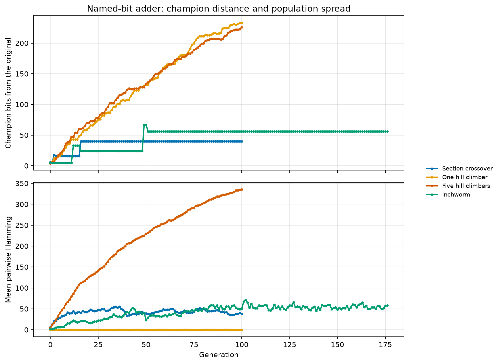

*Figure 7. Champion distance from the original, and mean pairwise Hamming. The single hill climber's pairwise distance stays at 0 because its population is one genome.*

| Run | Generation 0 | Peak | Last rise | Champion at the last rise | Champion at the end | Pairwise Hamming, last rise to end |
| --- | --- | --- | --- | --- | --- | --- |
| Section crossover | 0.250 (4/16) | 0.625 (10/16) | generation 16 | 40 bits | 40 bits | about 41 to 38 |
| One hill climber | 0.000 | 0.250 (4/16) | generation 5 | 17 bits | 233 bits | 0, one genome |
| Five hill climbers | 0.000 | 0.375 (6/16) | generation 8 | 36 bits | 226 bits | about 61 to 336 |
| Inchworm | 0.250 (4/16) | 0.500 (8/16) | generation 51 | 56 bits | 56 bits | about 29 to 58 |

Section crossover and inchworm freeze the champion at the generation of the last improvement. The hill climbers do the opposite. After the last improvement their winning genome keeps walking, and it ends more than 200 bits from the original at the same score it had at generation 5 or 8.

Inchworm's best score rises in steps and reaches 8/16 at generation 51. It is still there at generation 176, with the boosted rate at its cap of 40 for the five fastest children. The champion does not move during that long flat stretch. The population around it widens, from about 29 bits to about 58.

### Analysis

- Section crossover gains 6 rows by generation 16 and then holds a champion 40 bits from the original, with the population staying near 40 bits apart. That is the reference stall on this genome.
- The hill climbers gain 4 and 6 rows from a start of 0, which is the damaged seed itself. The score stalls early. The genome does not. A tie-accept rule turns the stall into a walk.
- Inchworm spends much longer climbing (the last rise is generation 51) and gains 4 rows, ending at 8/16. During the following 125 generations the boosted children spread out, and the champion stays put. Does raising the rate on the weakest children move the search, or only the cloud around a winner that is already fixed?
- The single climber's pairwise distance cannot say anything about diversity. Its champion distance is the whole story.

### Why XOR was used next

The adder's best score had gone flat under several ways of moving. The flip count was the obvious knob, and the adder runs had not held it fixed while changing nothing else. XOR is a smaller circuit with the same kind of fault and the same section-crossover loop, so a sweep of flip counts could be finished in 25 generations.

## 6. XOR as a probe of step size

### Why this experiment

The adder plateaus left open whether the stall was a mutation-rate problem. These runs keep every other setting fixed and change how many bits a child is expected to flip. Two further runs then let that number move during the search, because a single fixed rate cannot adjust, and because 32 flips was the only fixed rate that raised the score.

### Setup

| Setting | Value |
| --- | --- |
| Circuit | XOR, tile (8, 1) |
| Genome | the same 807 named bits, 274 sections |
| Fault | seed 42. Cleared genes 22, 35, 38, and 80. The damaged circuit scores 10/20 |
| Population | 10. One damaged genome plus 9 mutants |
| Elites | 3, copied and not scored again |
| Parents and crossover | fitness-proportional parents. Each section from either parent with probability 0.5 |
| Generations | 25, all completed |
| Fitness | correct measurements / 20 |

The five fixed-rate runs differ only in the expected flip count: 1, 4, 16, 32, or 64. Each bit then flips with probability (count) / 807.

The power-law run draws a flip count for each child from a power law with beta 1.5, so small counts are more common, and then flips each bit with probability (drawn count) / 807. The draws across the run averaged about 13 flips.

The half-or-double run starts at 1 expected flip. Each generation, half the children use half the current rate and half use double it. The rate then moves to whichever half scored higher. A tie keeps the higher rate. The rate can climb as far as half the genome.

### What the overlay shows

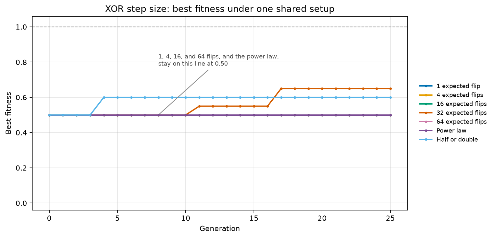

*Figure 8. Best fitness for the XOR step-size runs. Five runs lie on the same line at 0.50. Half-or-double leaves that line at generation 4. Thirty-two flips leaves it at generation 11 and again at generation 17.*

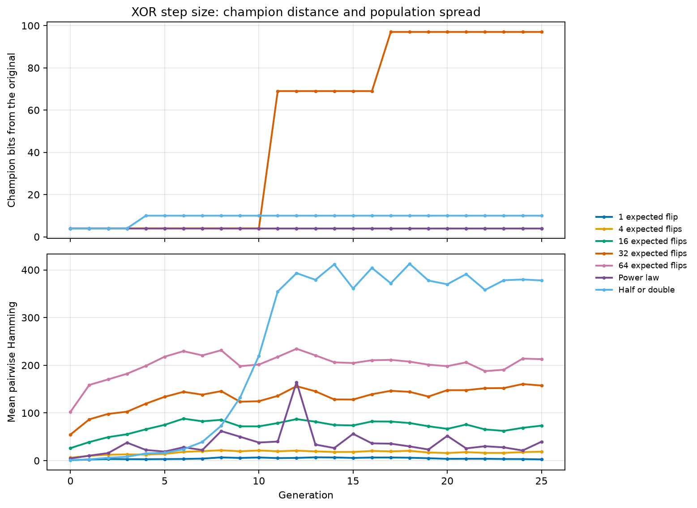

*Figure 9. Champion distance and population spread for the same runs. Distance stays at 4, the fault itself, for every run whose score never rose.*

| Run | Best fitness | Last rise | Champion at the end | Pairwise Hamming at the end | Board tests |
| --- | --- | --- | --- | --- | --- |
| 1 flip | 0.50 | none | 4 bits | about 3 | 152 |
| 4 flips | 0.50 | none | 4 bits | about 19 | 184 |
| 16 flips | 0.50 | none | 4 bits | about 73 | 185 |
| 32 flips | 0.65 (13/20) | generation 17 | 97 bits | about 158 | 185 |
| 64 flips | 0.50 | none | 4 bits | about 213 | 185 |
| Power law | 0.50 | none | 4 bits | about 40 | 181 |
| Half or double | 0.60 (12/20) | generation 4 | 10 bits | about 378 | 177 |

The 64-flip run was restarted once after the serial port dropped, then finished. From 1 flip through 32, the population's final spread rises by about 5 bits for each extra expected flip. At 64 flips the population is less spread than that line. The power-law run, whose draws averaged about 13 flips, ends between the 4-flip spread and the 16-flip spread.

Half-or-double reaches 12/20 at generation 4, with the champion 10 bits from the original. The rate then climbs to about 404 expected flips and the score stays at 12/20. The population ends about 378 bits apart. The champion does not move again.

The 32-flip champion jumps away from the original at the two generations where the score rises, and then stays at 97 bits. Its population is already widely spread when that happens, and the spread stays near 150 bits.

### Analysis

- Only two runs climb, and neither gets past 13/20. The climb is 3 measurements for 32 flips and 2 measurements for half-or-double.
- Spread and score come apart. The widest populations are half-or-double and 64 flips. One of those gained 2 measurements. The other gained none. The run that gained the most, 32 flips, is spread out, and it is not the most spread out.
- Whenever the score never rises, the champion is still the 4-bit fault. The population can be hundreds of bits apart while the winner has not moved.
- Half-or-double finds its only improvement early, at a small rate, and the rate then runs away. That is a candidate explanation for taking the rate control back to the adder with a cap, and with a reward that can shrink the rate. See whether you agree before using it.

### Why the adder grew a bandit

The flip count mattered, and so did the fact that a high count scatters flips across the whole genome. The next adder runs still use section crossover, then spend a fixed budget of flips inside sections chosen by a bandit, so the search can learn which parts of the tile are worth touching.

## 7. Choosing where the flips land

### Why these experiments

The XOR sweep said that 32 flips could move a score when 1, 4, 16, and 64 could not, and that an uncapped adaptive rate would climb away from the improvement it had found. The bandit runs bring both lessons back to the 2-bit adder. The first spends exactly 32 flips inside sections chosen by UCB. The second lets the flip count shrink or grow, with a reward that distinguishes a rise from a drop. The third is a correction of the second: the count had collapsed to half a flip and stayed there, so the floor was raised to one flip, a drop and a tie were both scored as no reward, one elite replaced three, and the fault was a new draw.

### Shared setup

| Setting | Value |
| --- | --- |
| Circuit | 2-bit adder, tile (20, 20) |
| Genome | 807 named bits, 274 sections |
| Crossover | fitness-proportional parents, each section from either parent with probability 0.5, then an exact number of flips |
| Where the flips go | UCB draws sections until they can hold that many flips, then flips inside them. Only sections that received a flip are updated |
| Generation 0 | the damaged tile plus exact-flip mutants. This generation does not train the bandit |
| Extra cost | the crossover child is scored, and then the mutant is scored, whenever the crossover child is not already cached |

The bandit does not see the output vector. Its reward is computed from the match count. A mutation that changes which rows pass, and keeps the same number correct, is treated as no change.

The three runs do not share a reward, a flip schedule, or a fault. Those are the experiment.

| Setting | 32 flips | Shrinking count | Floor of 1 |
| --- | --- | --- | --- |
| Fault seed | 42. Genes 26, 41, 235, 286 | 42. Same genes | 7. Genes 74, 128, 139, 236 |
| Population | 15 | 15 | 15 |
| Elites | 3 | 3 | 1 |
| Flip count | 32, fixed | starts at 4. Half the children use half, half use double. A tie keeps the lower count. Stays between 0.5 and 32 | same split, starting at 4, but the count stays between 1 and 32 |
| Reward for a flipped section | +1 if fitness changes in either direction, −1 if it is unchanged | +1 on a rise, 0 on a drop, −1 if unchanged | +1 on a rise, 0 on a drop or an unchanged score |
| Planned generations | 200, stopped at 102 | 100, stopped at 70 | 200, stopped during 138. History runs through 137 |
| Board tests | 2463 | 1458 | 3841 |

### What the overlay shows

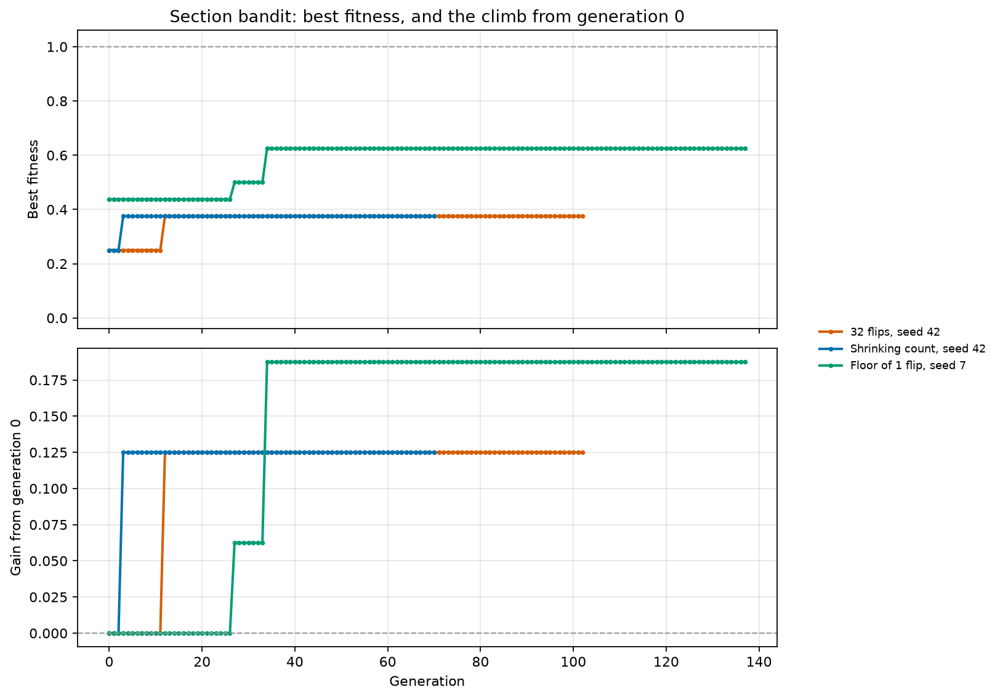

*Figure 10. Best fitness for the three bandit runs, and the gain from each run's own generation 0. Seed 7 starts higher because it is a different fault.*

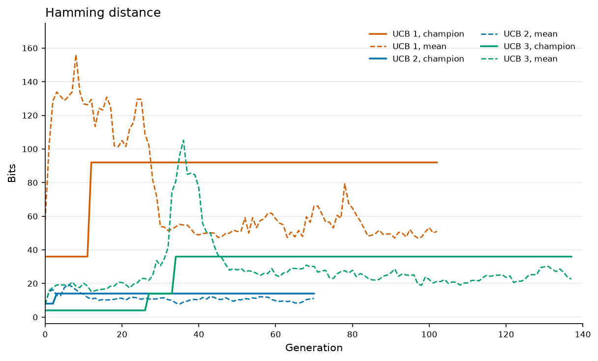

*Figure 11. Champion distance and population spread. In all three runs the champion freezes at the last improvement, and the population then pulls inward.*

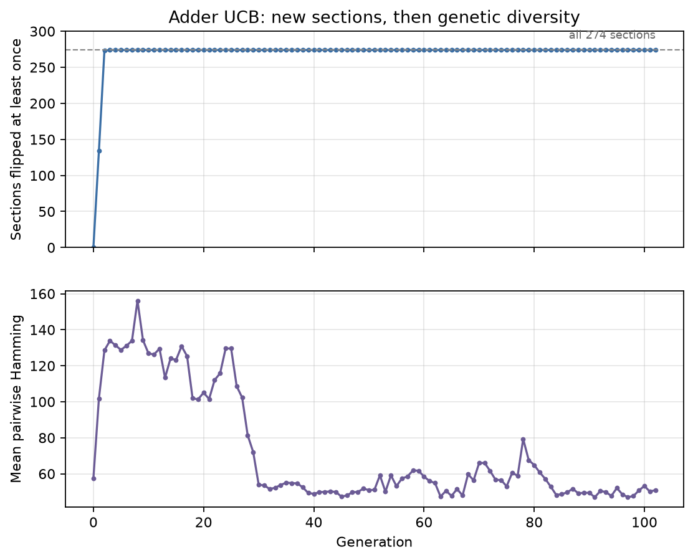

*Figure 12. The 32-flip, seed-42 run only. Every named section has been flipped at least once by generation 3. Pairwise Hamming peaks near 155 and then falls to about 50.*

| Run | Generation 0 | Peak | Last rise | Rows gained | Champion, frozen at | Pairwise Hamming, last rise to end |
| --- | --- | --- | --- | --- | --- | --- |
| 32 flips, seed 42 | 0.250 (4/16) | 0.375 (6/16) | generation 12 | 2 | 92 bits | about 130 to 51 |
| Shrinking count, seed 42 | 0.250 (4/16) | 0.375 (6/16) | generation 3 | 2 | 14 bits | about 13 to 11 |
| Floor of 1, seed 7 | 0.438 (7/16) | 0.625 (10/16) | generation 34 | 3 | 36 bits | about 81 to 23 |

On the shrinking run the flip count is 0.5 from generation 7 through the stop at generation 70. The population ends about 11 bits apart. Seed 7's count falls to the new floor of 1 and stays there. Its best score is 10/16, the same finishing score as section crossover, from a healthier start: 7/16 rather than 4/16.

### Analysis

- On a shared fault, both seed-42 bandits gain 2 rows. One of them spends 32 flips and ends with a champion 92 bits away. The other shrinks to half a flip and ends 14 bits away, at the same score. Same climb, very different genome.
- Seed 7's final score matches section crossover at 10/16. The gain does not. Count rows gained, and also say how much of the gap from the start up to 1.0 was closed.
- Figure 12: every section has been tried by generation 3, before the last rise in fitness at generation 12. From that last rise on, the score stays at 6/16 and pairwise Hamming falls from about 130 to about 50.
- The reward changed between these runs, so they are not three replicates of one algorithm. If you compare them, say which difference you are willing to attribute to the flip schedule, which to the reward, and which to the fault.

### Why the next run is built the way it is

The shrinking bandit stopped moving because the count sat on the floor. The hill climbers were the runs in which the champion itself kept changing after the score stopped rising. The run that is going now takes the stall-triggered rate from inchworm and the tie-replacement from the hill climbers, and it records the drift so the stall can be described after the fact.

## 8. The run that is still going

This run has not produced a result. Generation 0 and generation 1 are on disk. The damaged adder scored 0.188 (3/16). There is no fitness figure here until more generations finish.

### Setup

The search is called SAGA. It is the 2-bit adder on tile (20, 20), genome of 807 named bits, fitness correct rows out of 16. It is planned for 300 generations and does not stop at a perfect score. Output is `adder2/evolution/out/saga_4bit_g300_m2_p21_e1_seed13/`.

| Setting | Value |
| --- | --- |
| Fault | seed 13. Cleared genes 85, 125, 245, and 517. A different break from seed 42 and seed 7 |
| Evolution seed | 14 |
| Population | 21, with 1 elite |
| Generation 0 | 6 exact copies of the damaged genome and 15 mutants at 4/807 |
| Later generations | the one elite, plus 20 children |
| Crossover | the same even section split |
| The elite | copied, not mutated, not scored again. A strictly better child replaces it. If none is better, a child that ties the elite and is not an exact copy can replace it. That replacement is a drift step and does not reset the rate |
| Mutation | 13 children stay at 2/807. The 7 children with the weakest parents use a stalled rate: 2, then 6, 10, and so on up to 34. The first rise is at stall 3, then every 3 generations. A strict improvement puts the children back to 2/807. A tie replacement does not |
| What each generation stores | the whole population and its scores, pairwise Hamming, the elite's distance from the original, from generation 0, and from 10 generations ago, the same windows for the majority genome, the centroid's movement, the fraction of children that tie the elite, the stall, and the rate the next children will use |

### Analysis

Leave this until the run has a stall, or a recovery, to talk about. The plots worth making then are the same pair used above: best fitness and the gain from the damaged start, then champion distance against population spread. `analysis/plot_saga.py` draws those from whatever generations have finished.

The comparison this run is set up to answer:

- Does a rate that grows only while the elite's score is stuck, and that resets on a real improvement, climb further than inchworm did on seed 42?
- Does letting a tie replace the elite produce the walk the hill climbers showed, and does that walk stay near the score or wander off it?
- Seed 13 starts at 3/16. Count the climb from that floor.

## 9. Across the open adder

The narrow runs are left out of this comparison. They close the whole gap, in a space of 16 or 256 genotypes. Everything below is the 2-bit adder once the tile is open, scored as correct rows out of 16. The bar is the gain from generation 0's best, not from a shared damaged score. Seed 7 is a different fault and starts at 7/16. The large-step run's damaged seed scored 0, while its generation 0 already scored 6/16.

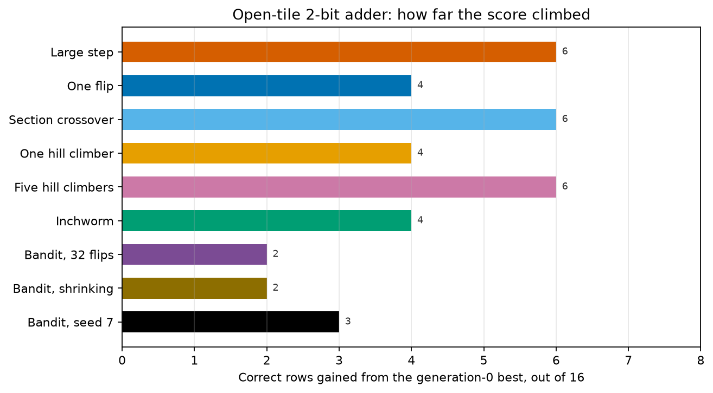

*Figure 13. Correct rows gained from the generation-0 best. The largest gain in this set is 6 rows out of 16. None of these runs reach 16/16.*

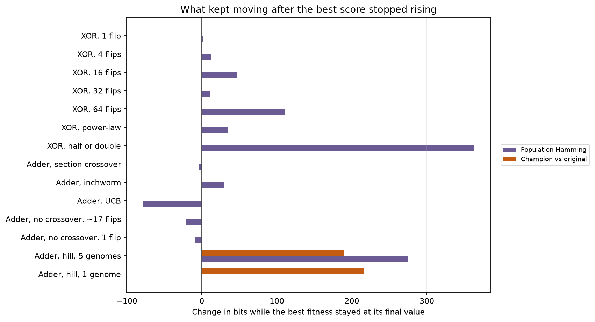

*Figure 14. What still moved after the best fitness had reached the value it finished on. Population Hamming can rise or fall. Champion distance changes on the two hill climbers and stays put on the elitist runs.*

### Analysis

This is the section the report is building toward. The per-experiment notes above are the material. A reading that is available, and that you should rewrite in your own terms if you use it:

The open tile never finishes the repair. The score that comes back is 2 to 6 rows, and it arrives early relative to how long the run then sits there. At the generation of that last improvement the champion is already tens of bits from the original, so the partial repair is a different circuit, not the four fault bits put back.

After that, elitist runs freeze the winner. The population either pulls in toward it (the small step, the bandits) or keeps spreading around it (inchworm, and the XOR half-or-double run). The hill climbers are the other stall: the score is constant and the champion walks for the rest of the run.

What I would want this section to decide:

- Is the right summary "rows gained before the freeze," and does generation 0 or the damaged seed make the fairer floor?
- Are the two stalls actually different search behaviors, or the same behavior with a different accept rule?
- Which single comparison is the one a reader should remember: section crossover against the hill climbers, the XOR flip sweep, or the three bandits?
- What this study does not show: a recovery rate over many faults, a random-start control, or a random search at the same evaluation budget. Those were the baseline the proposal asked for. They belong here as the limit of the claim, or as the next measurement.

                                                                                                                                                                                                                                                                          eePer-run sheets are still in each output folder: `fitness_over_generations.png`, `hamming_diversity.png`, `final_circuit.png`, and `ucb_sheet.png` for the bandit runs. Pull one into an analysis paragraph when a single run needs to be unpacked. The overlays above are the comparisons.
